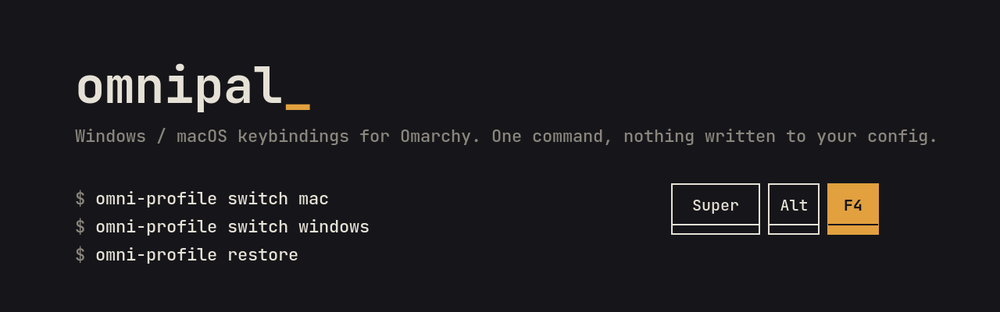
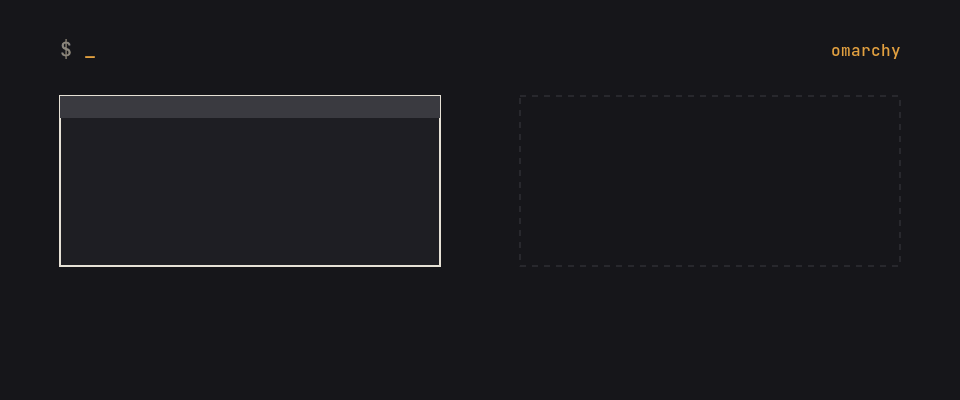

<p align="center"></p>

# OmniPal

把 Windows / macOS 的桌面习惯一键带到 Omarchy（Hyprland）：快捷键方案随心切换，外加任务视图、可视化窗口吸附、mac 风格 Dock 与设置中心。所有覆写只在内存里生效，不碰你现有的配置文件，随时一键还原。

<p align="center"></p>

## 安装

```bash
git clone https://github.com/vsex7/OmniPal.git
cd OmniPal && bash scripts/install.sh
```

要求 **Omarchy 4.5.0 或更新版本**（每个插件的 `manifest.json` 里以 `minOmarchy` 声明）。安装脚本会通过 `pacman -Q omarchy`（或 `$OMARCHY_PATH/version`）检测版本：版本过旧会拒绝安装；无法检测时只给出警告并继续安装，装好后请运行 `omni-profile doctor`，其中「Omarchy 版本」一项会显示 正常 / 过旧 / 未知。

装好后不要移动这个目录。卸载请运行 `bash scripts/uninstall.sh`，会删掉安装时加上的所有文件。

## 用法

```bash
omni-profile switch windows   # Windows 11 习惯（Win+D 显示桌面、Win+Shift+方向键跨屏移动等）
omni-profile switch mac       # macOS 习惯（Cmd+Opt+D 呼出 Dock、Cmd+H 最小化、快捷键转发等）
omni-profile restore          # 回到 Omarchy 原生键位
omni-profile cheatsheet       # 当前模式的快捷键（可加 --with-omarchy 并排查看原生特性）
omni-profile doctor           # 出问题时先跑这个（含硬件平台智能模式推荐）
omni-profile desktop          # 显示桌面 / 最小化当前工作区所有窗口，再次按下还原
omni-profile titlebars toggle # 切换窗口标题栏（状态自动持久化记忆，重启自动恢复）
omni-profile unpin            # 解除窗口置顶/固定（Super+O）
omni-profile window-policy set follow-profile   # 窗口策略：follow-profile 跟随模式 / tiled 平铺 / floating 浮动
```

日常操作都可以在 OmniPal 设置（`Super+Alt+I`）里完成：模式切换、窗口策略、窗口标题栏记忆、配置持久化等。状态栏左键单击轮转到下一模式；右键菜单提供常用功能（模式切换、窗口策略、速查表、贴靠布局、概览、还原 Omarchy 原生模式、健康诊断、首次使用引导、打开设置），两处都可用。在设置里选择「Omarchy 原生模式」就是还原（等同 `omni-profile restore`）。

### 窗口策略与标题栏记忆

- **窗口策略**：默认为「跟随模式」，每个模式文件里的 `window_mode`（`tiled` 平铺 / `floating` 浮动）决定该模式下新窗口的布局。`omni-profile window-policy set tiled|floating` 设置全局平铺/浮动，会覆盖各模式自带的设置；`omni-profile window-policy set follow-profile` 恢复跟随模式。开启配置持久化时窗口策略一并记住。
- **窗口标题栏记忆**：通过 `omni-profile titlebars on|off|toggle` 或控制中心切换窗口标题栏开关状态；该状态与模式一并持久化记录于 `~/.config/omnipal/persistence.json`，在系统重启、守护进程重连或配置重载（`hyprctl reload`）时全自动精准恢复。

## 固定入口（所有模式通用）

无论当前是哪个模式（包括 Omarchy 原生模式），下面三个组合键都由引擎注入，模式文件不能改它们：

| 组合键 | 打开 |
|---|---|
| `Super+Ctrl+/` | 快捷键速查表（原生模式下直接展示 Omarchy 4.5 原生与智能体快捷键） |
| `Super+Alt+I` | OmniPal 控制中心 |
| `Super+Alt+O` | 概览 |

它们都不占用 Omarchy 默认快捷键。各模式自己的别名（如 Windows 模式的 `Super+Tab` 概览、macOS 模式的 `Super+Up` 概览）照常可用（Omarchy 4.5 原生预留 `Super+I` 为输入法切换，OmniPal 控制中心统一使用固定组合键 `Super+Alt+I`，并在受保护键位表中锁定 `Super+I` 严禁覆盖）。定义在 `schema/fixed_bindings.json`，`scripts/check_consistency.py` 会拒绝把这些组合键绑到其他动作的模式文件。

## 包含什么

- **三套习惯模式**：
  - **Windows**：Alt+F4 关闭窗口、Win+D 显示桌面/最小化所有窗口、Win+方向键吸附、Win+Shift+Left/Right 跨显示器移动窗口、Win+E 文件管理器、Win+V 剪贴板、Win+Z 布局选择器。
  - **macOS**：Super+Q 退出程序、Super+Space 启动器、Super+Shift+3/4 截图、Cmd+Opt+D 切换 Dock、Cmd+H 最小化窗口、基于 Lua 脉冲的精准 Cmd→Ctrl 应用快捷键转发（Cmd+W 关标签页、Cmd+T 新建标签等，终端改发 Ctrl+Shift）。
  - **Omarchy 原生模式**：完全还原系统原生键位，零覆盖。
- **Omarchy 4.5 智能体与原生协同**：
  - 快捷键速查表（`Super+Ctrl+/` 或 `omni-profile cheatsheet --with-omarchy`）深度集成 Omarchy 4.5 核心能力展示：Quake 智能体终端（`Super+~`）、Superwhisper 语音输入（`Alt+Space`）、输入法切换（`Super+I`）、工作区布局循环（`Super+L`）、窗口最小化到 Dock（`Super+M`）、系统菜单（`Super+Space`）等。
  - 原生应用自主尺寸保护：`Monologue` 录音、`Omacut` 视频剪辑、`Signed` 签名、`Disktree` 磁盘分析等原生应用纳入白名单，浮动策略下杜绝强行拉伸变形。
- **硬件平台智能探测**：`omni-profile doctor` 自动探测系统硬件平台（DMI 厂商与 Apple Silicon 设备树），在 Apple 设备推荐 `mac` 模式，在通用 PC 推荐 `windows` 模式。
- **窗口吸附**：半屏、三分之一、三分之二、居中，`Win+Z` 呼出布局选择器。
- **Quickshell 插件**：顶栏模式指示器、快捷键速查表（`Super+Ctrl+/`）、设置中心（`Super+Alt+I`）、任务视图（`Super+Alt+O`，跨桌面窗口概览）、可视化吸附布局选择器（`Win+Z`）（底部 Dock 由 Omarchy 4.5 原生提供并无缝集成）。
- **自定义模式**：在 `~/.config/omnipal/profiles/` 放 JSON，或用 `omni-profile import` 导入别人分享的。

## 更多

- [按应用自动切换模式](docs/APP_RULES.md)
- [自定义 profile 编写指南](docs/PROFILE_GUIDE.md)
- [完整功能与命令参考](docs/REFERENCE.md)
- [常见问题](docs/FAQ.md)
- [更新日志](CHANGELOG.md)

需要 Omarchy 或 Hyprland。遇到问题请[提 issue](https://github.com/vsex7/OmniPal/issues)，附上 `OMNIPAL_DEBUG=1 omni-profile doctor` 的输出。
