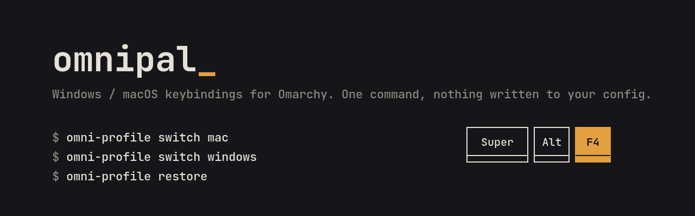
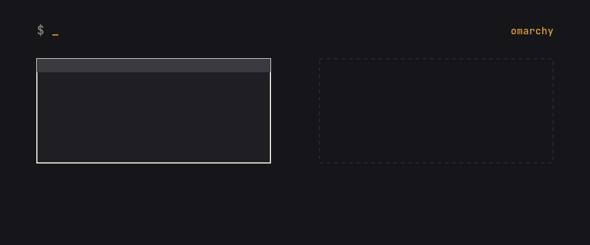

<p align="center"></p>

# OmniPal

在 Omarchy（Hyprland）上一条命令切换 Windows 或 macOS 的快捷键习惯。只在内存里生效，不改你现有的配置文件，随时切回原生键位。

<p align="center"></p>

## 安装

```bash
git clone https://github.com/vsex7/OmniPal.git
cd OmniPal && bash scripts/install.sh
```

要求 **Omarchy 4.0.4 或更新版本**（每个插件的 `manifest.json` 里以 `minOmarchy` 声明）。安装脚本会通过 `pacman -Q omarchy`（或 `$OMARCHY_PATH/version`）检测版本：版本过旧会拒绝安装；无法检测时只给出警告并继续安装，装好后请运行 `omni-profile doctor`，其中「Omarchy 版本」一项会显示 正常 / 过旧 / 未知。

装好后不要移动这个目录。卸载请运行 `bash scripts/uninstall.sh`，会删掉安装时加上的所有文件。

## 用法

```bash
omni-profile switch windows   # Windows 11 习惯
omni-profile switch mac       # macOS 习惯
omni-profile restore          # 回到 Omarchy 原生键位
omni-profile cheatsheet       # 当前模式的快捷键
omni-profile doctor           # 出问题时先跑这个
omni-profile window-policy set follow-profile   # 窗口策略：follow-profile 跟随模式 / tiled 平铺 / floating 浮动
```

日常操作都可以在 OmniPal 设置（`Super+Alt+I`）里完成：模式切换、窗口策略、配置持久化等。状态栏左键单击轮转到下一模式；右键菜单提供常用功能（模式切换、窗口策略、速查表、贴靠布局、概览、还原 Omarchy 原生模式、健康诊断、首次使用引导、打开设置），两处都可用。在设置里选择「Omarchy 原生模式」就是还原（等同 `omni-profile restore`）。

### 窗口策略

窗口策略默认为「跟随模式」：每个模式文件里的 `window_mode`（`tiled` 平铺 / `floating` 浮动）决定该模式下新窗口的布局。`omni-profile window-policy set tiled|floating` 设置全局平铺/浮动，会覆盖各模式自带的设置（状态栏菜单、设置、模式卡片与 `doctor` 都会标注「已覆盖」）；`omni-profile window-policy set follow-profile` 恢复跟随模式。`omni-profile window-policy`（可加 `--json`）查看当前策略、每个模式的平铺/浮动以及当前生效值。开启配置持久化时窗口策略一并记住（`persist enable --policy <follow-profile|tiled|floating>`）。

## 固定入口（所有模式通用）

无论当前是哪个模式（包括 Omarchy 原生模式），下面三个组合键都由引擎注入，模式文件不能改它们：

| 组合键 | 打开 |
|---|---|
| `Super+Ctrl+/` | 快捷键速查表 |
| `Super+Alt+I` | OmniPal 控制中心 |
| `Super+Alt+O` | 概览 |

它们都不占用 Omarchy 4.0 的默认快捷键。各模式自己的别名（如 Windows 模式的 `Super+Tab` 概览、`Super+I` 控制中心，macOS 模式的 `Super+,`）照常可用。定义在 `schema/fixed_bindings.json`，`scripts/check_consistency.py` 会拒绝把这些组合键绑到其他动作的模式文件。

## 包含什么

- **三套习惯模式**：Windows（Alt+F4、Win+方向键吸附、Win+E）、macOS（Super+Q、Super+Space、Super+Shift+3/4）、Omarchy 原生模式（还原系统原生键位）。
- **窗口吸附**：半屏、三分之一、三分之二、居中，`Win+Z` 呼出布局选择器。
- **Quickshell 插件**：顶栏模式指示器、快捷键速查表、设置中心、吸附反馈、任务视图、Dock。
- **自定义模式**：在 `~/.config/omnipal/profiles/` 放 JSON，或用 `omni-profile import` 导入别人分享的。

## 更多

- [按应用自动切换模式](docs/APP_RULES.md)
- [自定义 profile 编写指南](docs/PROFILE_GUIDE.md)
- [完整功能与命令参考](docs/REFERENCE.md)
- [常见问题](docs/FAQ.md)
- [更新日志](CHANGELOG.md)

需要 Omarchy 或 Hyprland。遇到问题请[提 issue](https://github.com/vsex7/OmniPal/issues)，附上 `OMNIPAL_DEBUG=1 omni-profile doctor` 的输出。
